<h3><code>Dhyey-Somaiya@github ~ $ whoami</code></h3>

<table>
<tr>
<td valign="top"></td>
<td valign="top"></td>
</tr>
</table>

 

<h3><code>Dhyey-Somaiya@github ~ $ ./contributions.sh</code></h3>

 

<h3><code>Dhyey-Somaiya@github ~ $ ./links.sh</code></h3>

<b>Computer Engineering Student · AI/ML · Location Intelligence</b>

---

### What I'm building

I'm a Computer Engineering student interested in applied AI/ML, location intelligence, and building useful software.

- **GeoVenture** — Location intelligence using React, FastAPI, GeoPandas, H3, and Leaflet.
- **CampusConnect** — A campus collaboration platform with role-based workflows.
- **TaskFlow** — A task management project.
- **Harmonia** — A mood-based music player.

### Tech I'm exploring

`Python` · `C/C++` · `Machine Learning` · `FastAPI` · `React` · `TypeScript` · `SQL` · `Git`

Profile art generated locally with Python and SVG. Contribution graph refreshed by GitHub Actions.
